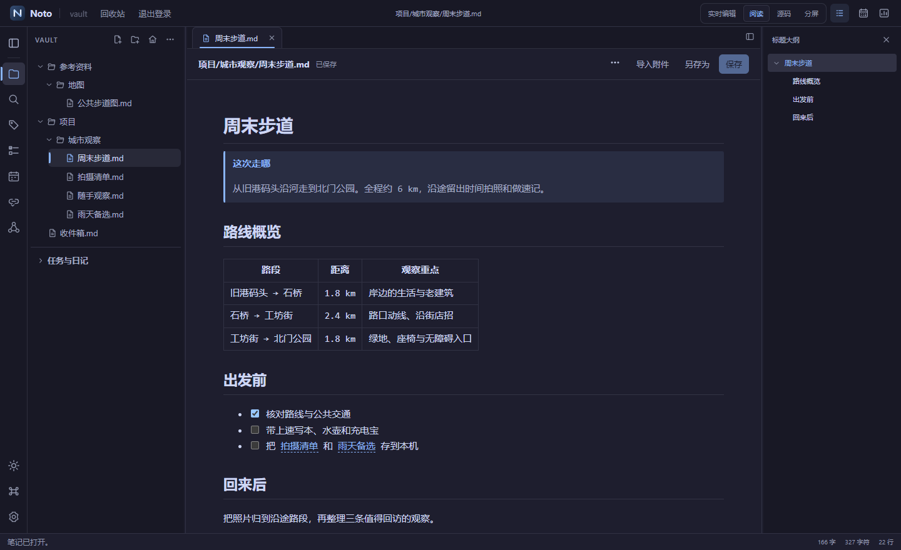
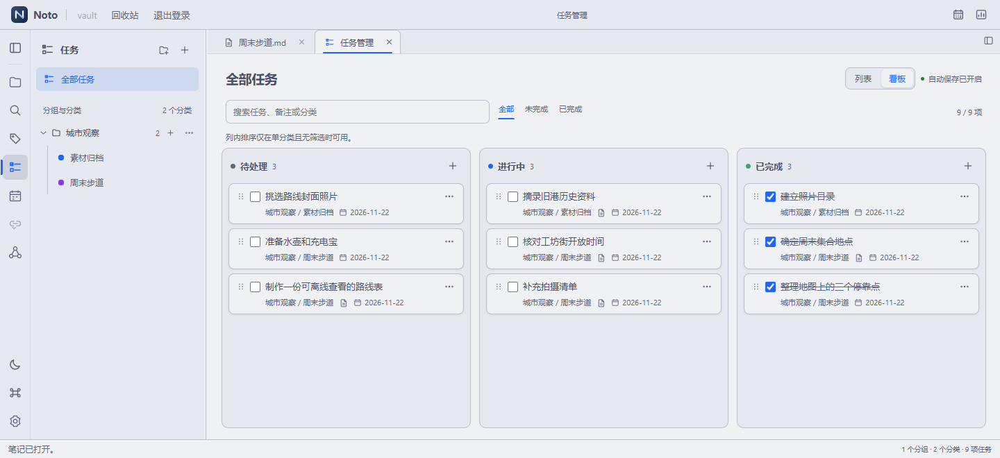

# Noto

Noto 是一款本地优先的 Markdown 笔记工具，适合写技术笔记、整理资料和跟进个人项目。打开一个文件夹，就能在同一个工作区写笔记、阅读 PDF、规划任务和绘制草图。

[功能概览](#功能概览) · [下载](https://github.com/chongweiwang/Noto/releases) · [Windows 桌面](#windows-桌面) · [WSL Docker](#wsl-docker)



## Noto 的特点

- **知识库就是普通文件夹**。已有的 Markdown 文件夹可以直接打开。笔记、附件、画布和白板都保存在知识库里，备份时可以直接复制文件夹，Markdown 也能用其他编辑器打开。
- **Windows 离线使用或通过 Docker 自托管**。桌面版直接读写你选的本地目录。网页版在你自己的服务上运行，用浏览器打开服务挂载的知识库。
- **自动保存与文件恢复**。写作时自动保存，桌面启动时可以恢复上次的知识库和标签页。使用本机草稿或 Markdown 历史快照可以找回先前的编辑。

## 功能概览

### Markdown 写作与阅读

- 在实时编辑、源码、阅读和编辑预览分屏之间切换。另有独立的左右双栏，可以在一侧查资料，在另一侧写笔记。长文可通过大纲跳转到指定标题。
- 支持 LaTeX 公式、Mermaid 图、表格、代码块和任务复选框。编辑器右键菜单支持剪切、复制、粘贴和全选。图片可直接粘贴或拖入，附件随笔记保存在知识库里。
- 可选择浅色或深色主题，调整编辑字体和字号。

### 搜索、标签与笔记关联

- 用 `Ctrl+P` 快速打开文档，或用全库搜索查找正文并跳到命中位置。高级搜索支持目录筛选、正则表达式和 YAML 属性。批量替换可以先预览，PDF 搜索可以定位到包含目标文字的页面。
- 在正文中用 `#技术/电机控制` 这样的层级标签给笔记分类。标签侧栏可以浏览父标签和子标签，也可以组合多个标签筛选，选择全部匹配或任意匹配。
- 使用 `[[笔记]]` 链接其他笔记，用 `[[笔记#标题]]` 跳转到指定标题。用反向链接查找引用来源，用全库或局部图谱浏览笔记之间的关系。整篇笔记或指定标题下的内容可以嵌入到其他笔记中阅读。

### 日记、任务与写作统计

- 从日历选择日期，直接新建或打开当天的 Markdown 日记。日记和任务有各自的入口，也归在文件树底部的「任务与日记」分组中。
- 按分类组织任务，用列表查看日期和备注，或在看板里拖动卡片来更新状态。比如把本周的项目事项从「待处理」拖到「进行中」。
- 笔记热力图按文件的创建和最近修改日期统计最近一年的笔记分布。仪表盘可以按目录查看笔记数、总字数、平均每篇字数、常用标签和篇幅最长的笔记。两个面板都能从顶部打开，也能在设置中单独隐藏。



### 知识画布、白板与 PDF

- **知识画布**适合梳理资料关系。把笔记、文本和图片放到画布上，用连线和分组组织内容。笔记卡片可预览已保存内容，也能直接打开原笔记。
- **绘图白板**适合画草图和说明图。用画笔、形状、箭头和文字表达想法，再把白板嵌入 Markdown 笔记中展示。
- **内置 PDF 阅读器**可以从文件树或笔记阅读视图中的链接打开 PDF，翻页、缩放，并添加高亮、下划线和文字批注。标注单独保存在知识库的 `PDF 标注/` 目录中。

### 导出、备份与演示

- 单篇笔记或多篇按指定顺序合并后，可以导出为 HTML，也可以通过打印另存为 PDF。常用纸张、方向、页边距可保存为导出预设。
- 知识画布和白板可导出 PNG 或 PDF，白板也可导出 SVG。需要迁移或备份时，可以把知识库中已保存的可见文件和附件打包成 ZIP。
- Markdown 可以直接在 Noto 内播放为幻灯片，用水平线分页，并可为每页添加演讲备注。

## Windows 桌面

在 Releases 中下载 `Noto-0.2.1-windows-x64-setup.exe` 安装，或解压 `Noto-0.2.1-windows-x64-portable.zip` 后直接打开 `Noto.exe`。桌面版使用 Microsoft Edge WebView2，安装包未签名。 [下载 Windows 版本](https://github.com/chongweiwang/Noto/releases)

### 从源码构建

开发需要 Node.js 22、npm 和 Rust。Windows 构建还需要 C++ Build Tools、Windows SDK 和 WebView2。参见 [Tauri 构建环境](https://v2.tauri.app/start/prerequisites/)。在仓库根目录安装依赖并启动开发版：

```powershell
npm.cmd --prefix desktop ci
npm.cmd run desktop:dev
```

构建可独立启动的 Debug 程序：

```powershell
npm.cmd run build:frontend
cargo build --locked -p noto-desktop --features custom-protocol
.\target\debug\noto-desktop.exe
```

也可以生成 Windows x64 安装包。产物位于 `target/release/bundle/nsis/`。

```powershell
npm.cmd --prefix desktop run tauri -- build --config src-tauri/tauri.installer.conf.json --bundles nsis --ci --no-sign -- --locked
```

## WSL Docker

在 x64 Windows 的 WSL 2 Ubuntu 中安装 Docker Engine 和 Compose 插件。以下命令在 Ubuntu 终端运行。 [安装 WSL](https://learn.microsoft.com/windows/wsl/install) · [安装 Docker Engine](https://docs.docker.com/engine/install/ubuntu/)

从 Releases 下载 `noto-0.2.1-linux-amd64.tar` 和同版本的 **Source code (zip)**。在 WSL 中解压源码，把 TAR 放在 `compose.yaml` 所在目录，再进入该目录。 [下载 Docker 镜像](https://github.com/chongweiwang/Noto/releases)

首次运行时创建知识库、服务数据目录和口令文件。下面的命令会在缺少 `.env` 时生成配置，目录与口令保存在 WSL 的 Linux 文件系统中。

```sh
noto_dir="$HOME/noto-workspace"
mkdir -p "$noto_dir/vault" "$noto_dir/data"

if [ ! -f "$noto_dir/password.txt" ]; then
  (umask 077; openssl rand -hex 24 > "$noto_dir/password.txt")
fi

if [ ! -f .env ]; then
  cat > .env <<EOF
NOTO_IMAGE=noto:v0.2.1
NOTO_VAULT_DIR=$noto_dir/vault
NOTO_DATA_DIR=$noto_dir/data
NOTO_PASSWORD_FILE=$noto_dir/password.txt
NOTO_UID=$(id -u)
NOTO_GID=$(id -g)
EOF
fi
```

导入镜像并启动原项目。默认只监听本机，Windows 浏览器可以打开 `http://localhost:3457`。使用前面生成的口令文件里的内容登录。

```sh
docker image load -i noto-0.2.1-linux-amd64.tar
docker compose config --quiet
docker compose up -d --no-build --pull never
```

升级时先保存笔记并备份 `vault` 和 `data`。导入新镜像后，在原 `.env` 中更新 `NOTO_IMAGE`，再运行 `docker compose up -d --no-build --pull never`。核对挂载权限可打开「软件设置 → 存储与诊断」。

从源码构建时可以使用 `NOTO_IMAGE=noto:local docker compose up -d --build`。也可以生成一个可分发的 x64 镜像归档：

```sh
docker buildx build --platform linux/amd64 --provenance=false --load \
  --build-arg NOTO_REVISION=v0.2.1 -t noto:v0.2.1 .
docker image save -o noto-0.2.1-linux-amd64.tar noto:v0.2.1
```

## 数据与同步

桌面端可直接打开本地知识库。使用文件同步工具时，已保存的笔记、任务、画布、附件和 PDF 标注会随知识库同步。切换设备接着编辑同一篇笔记前，先保存并等待同步完成。未保存草稿和软件设置各端保存。Noto 也提供手动 WebDAV 同步。

## 开发和测试

前端和桌面程序位于 `desktop/`，Axum 服务位于 `server/`，共享文件逻辑在 `crates/noto-core/`。示例知识库位于 `fixtures/vault/`。

```powershell
cargo test --locked --workspace
npm.cmd --prefix desktop test -- --maxWorkers 2
npm.cmd --prefix desktop run typecheck
```

## 许可与致谢

Noto 采用 [MIT 许可证](LICENSE)。部分编辑器和界面实现参考或适配自 [Noteriv](https://github.com/thejacedev/Noteriv)。其版权声明、许可和适配范围见 [第三方声明](third_party/noteriv/README.md)。
